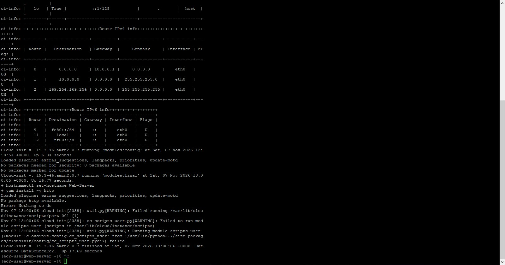
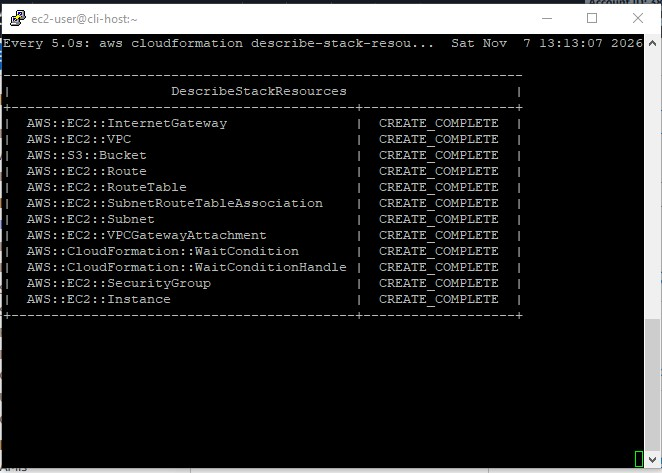
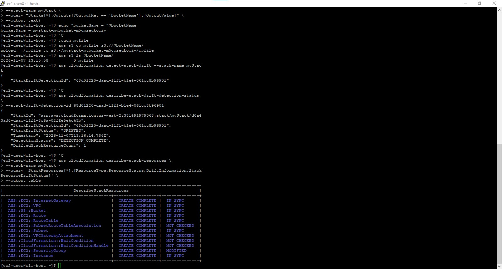
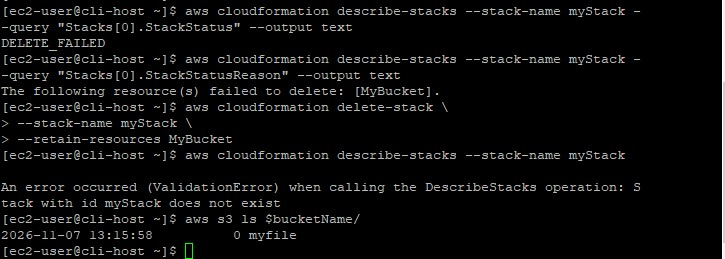

# AWS CloudFormation Troubleshooting & Drift Detection

## 📖 Project Overview
This repository documents a real-world Infrastructure as Code (IaC) troubleshooting scenario using AWS CloudFormation and the AWS CLI. 

**The Scenario:** A web server deployment inside a custom VPC is failing. The objective was to analyze the Linux logs, identify the root cause of the deployment failure, fix the YAML template, manage configuration drift caused by manual console changes, and safely delete the stack while preserving critical data in an S3 bucket.

## 🛠️ Skills Demonstrated
- **AWS CLI & JMESPath:** Querying complex JSON output to filter stack events and resource statuses.
- **Linux Log Analysis:** SSHing into EC2 instances to troubleshoot `cloud-init` userdata script failures.
- **Drift Detection:** Identifying and understanding manual changes made outside of the CloudFormation lifecycle.
- **Data Protection:** Safely deleting a CloudFormation stack while retaining an S3 bucket containing objects using `--retain-resources`.

---

## 🕵️‍♂️ Case Study 1: The Failed Deployment (WaitCondition Timeout)

### The Problem
Upon running `aws cloudformation create-stack`, the stack resources began provisioning, but eventually rolled back and failed. The `describe-stack-events` command revealed a `WaitCondition` timeout. 

### The Diagnosis
The template used a `WaitCondition` to ensure the EC2 UserData script completed successfully before moving on. I disabled rollback (`--on-failure DO_NOTHING`) to preserve the EC2 instance for investigation. 

By SSHing into the instance and checking the logs (`sudo tail -50 /var/log/cloud-init-output.log`), I found the exact error: `No package http available.`

### The Fix
The UserData script attempted to install a package named `http`. The actual package name for the Apache web server is `httpd`. I updated the `template1.yaml` file via `vim`, re-ran the deployment, and achieved a `CREATE_COMPLETE` status.

---

## ⚠️ Case Study 2: Detecting and Handling Drift

### The Problem
A manual change was made to the `WebServerSG` Security Group (changing the SSH inbound rule from `0.0.0.0/0` to a specific IP) outside of CloudFormation. 

### The Diagnosis
I initiated a drift detection run using `aws cloudformation detect-stack-drift`. I then queried the resource drift details using a JMESPath expression to format the output into a clean table.

### The Resolution
Attempting to run `update-stack` failed, as CloudFormation does not automatically resolve drift. To fix this in a real environment, the resource must be manually reverted or the template updated to match the new desired state.

---

## 🛡️ Case Study 3: The Deletion Challenge (Data Protection)

### The Problem
Running `aws cloudformation delete-stack` failed with a `DELETE_FAILED` status. CloudFormation refused to delete the S3 bucket (`MyBucket`) because it contained objects, which is a built-in safety mechanism to prevent data loss.

### The Solution
I needed to delete the stack but *keep* the S3 bucket and its data. I ran the delete command using the `--retain-resources` flag:

aws cloudformation delete-stack \
  --stack-name myStack \
  --retain-resources MyBucket

This successfully removed the CloudFormation stack state while leaving the S3 bucket and its files completely intact.

## 📚 Lessons Learned
- **The Green Banner Trap:** A successful CLI command does not mean the infrastructure was created. Always verify the actual resource state.
- **WaitConditions & UserData:** The `-e` flag in a userdata script will cause the script to exit immediately on failure, which is exactly what triggers a WaitCondition timeout.
- **Drift is Inevitable:** In real environments, people will make manual changes. Knowing how to detect and reconcile drift is a critical Cloud Engineering skill.
- **Protect Data at All Costs:** When tearing down infrastructure, always use `--retain-resources` for stateful resources like S3 buckets or databases to prevent accidental data loss.
